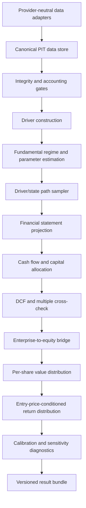

# DSDE Valuation Model Specification
## Independent Valuation & Conditional Return Engine — VMS-0.1

- **Type:** Engineering SPEC
- **System:** Dynamic State-Contingent Decision Engine (DSDE)
- **Component:** Valuation Model / Conditional Return Engine
- **Version:** VMS-0.1
- **Target:** Python 3.11+, China A-share equities initially
- **Dependency policy:** Fully standalone. Must not require existing PIT/FTD/DV1 code, an existing Fundamental Monte Carlo engine, or any legacy valuation component.

---

## 1. Purpose

Build the valuation component required for DSDE to operate as a genuinely new, independently runnable system. It must transform point-in-time financial and market data into coherent distributions of future business value, equity value, per-share value, and investment returns conditional on an entry price.

This is **not** a single-target-price predictor. It must answer:

1. What operating and fundamental states are plausible given information available at a specified decision timestamp?
2. What financial outcomes and cash-flow paths follow from those states?
3. What distributions of enterprise value, equity value, and per-share value follow?
4. How do return distributions change across entry prices and fundamental/market regimes?
5. Which assumptions and uncertainties dominate the result?

The model may later provide a documented adapter to DSDE's decision optimizer. The valuation core must run without DSDE installed and must not calculate portfolio-level Kelly position sizes or execute trades.

### 1.1 Core principles

1. Price and fundamental regime jointly determine investment odds.
2. Business value and market price are separate quantities.
3. Only information available at the historical decision timestamp may be used.
4. Distributions are primary outputs; point estimates are summaries.
5. Business drivers flow through financial statements, cash flow, capital allocation, valuation, and per-share value.
6. Process uncertainty, parameter uncertainty, regime uncertainty, data uncertainty, and model uncertainty must be distinguished.
7. All material assumptions must be explicit, versioned, and traceable.
8. Accounting consistency is a hard requirement.
9. LLM-generated scenarios are hypotheses, not calibrated probability estimates.
10. Engineering acceptance is not evidence of investment alpha.

---

## 2. Scope and non-goals

### In scope
- Point-in-time financial, price, corporate-action, and share-count data.
- Data-quality and accounting-integrity gates.
- Fundamental driver construction and regime estimation.
- Driver and regime path sampling.
- Financial statement and cash-flow projection.
- Capital allocation, debt, cash, dividends, buybacks, issuance, and dilution.
- FCFF DCF as the primary method for supported operating companies.
- Exit-multiple valuation as a separately reported cross-check.
- Enterprise-to-equity bridge.
- Price-conditioned, multi-horizon total-return distributions.
- Sensitivity, calibration, walk-forward evaluation, reproducible artifacts.
- Provider-neutral CLI and Python API.

### Out of scope
- Portfolio construction and Robust Kelly sizing (DSDE decision layer).
- Order execution or broker integration.
- Direct price prediction as the sole valuation method.
- Automatic assumption that DCF suits every sector.
- Treating peer multiples as ground truth.
- Using future restatements in historical evaluations.

---

## 3. Standalone system boundary

### 3.1 Inputs
- Instrument identifier and share class.
- Decision timestamp (`as_of`).
- Historical financial observations with public publication timestamps.
- Historical prices and corporate-action data.
- Shares outstanding / diluted shares, cash, debt, minority interest, and other equity-bridge items where available.
- Industry classification.
- Explicit configuration and valuation assumptions.
- Optional industry, macro, and peer data.

Missing values must remain missing or be filled by an explicit, labeled fallback. They must never be invented silently.

### 3.2 Outputs
- Point-in-time data snapshot and quality report.
- Fundamental-state posterior and driver diagnostics.
- Simulated driver and financial-statement paths.
- FCF and capital-allocation paths.
- EV, equity-value, and per-share-value distributions at requested horizons.
- Total-return distributions at configurable entry prices.
- Sensitivity and uncertainty attribution.
- Reproducibility metadata and validation report.

### 3.3 Dependency rule
The core must define its own domain models, contracts, configuration, tests, and adapters. It may use general numerical/data libraries, but must not import legacy system modules. A synthetic example must run offline without credentials.

Suggested dependencies: `numpy`, `pandas`, `scipy`, `pydantic` (or validated dataclasses), `pytest`. Every additional dependency must be justified.

---

## 4. Architecture



### 4.1 Module boundaries

| Module | Responsibility |
|---|---|
| `data/` | Canonical schemas and source adapters |
| `pit/` | Historical as-of snapshots and availability-time filtering |
| `quality/` | Missingness, restatements, accounting and integrity checks |
| `drivers/` | Driver definitions, transformations, bounds and features |
| `regimes/` | Fundamental-state labels/posteriors and transition estimation |
| `sampling/` | Correlated driver paths and parameter uncertainty |
| `statements/` | Income statement, balance sheet, and cash-flow projection |
| `capital_allocation/` | Reinvestment, dividends, buybacks, debt and dilution |
| `valuation/` | FCFF DCF and separately reported multiple cross-check |
| `equity_bridge/` | EV-to-equity and per-share conversion |
| `returns/` | Price-conditioned shareholder-return distributions |
| `diagnostics/` | Calibration, sensitivity and attribution |
| `evaluation/` | Walk-forward evaluation |
| `reporting/` | Human- and machine-readable run bundles |
| `cli/` | Reproducible command-line interface |

Each module must have typed inputs/outputs and unit tests. No module may silently read another module's private state.

---

## 5. Canonical data contracts and PIT rules

### 5.1 Required timestamps and provenance

Each financial observation must distinguish:
- `period_end`: period described.
- `published_at`: when information became public.
- `ingested_at`: when retrieved.
- `source_id`: source/document identifier.
- `revision_id`: restatement/revision identifier, if available.
- `quality_status`: observed, derived, missing, not applicable, or low confidence.

A record may enter an `as_of` snapshot only when `published_at <= as_of`. A later restatement must not overwrite the value that was known at an earlier decision timestamp. If historical versions cannot be reconstructed, mark the data `PIT_INCOMPLETE`; do not use it to claim unbiased historical performance.

### 5.2 Canonical financial fields

**Income statement:** revenue, cost of revenue, gross profit, operating expenses, EBIT, interest expense, tax expense/effective tax rate, parent-attributable net income, depreciation and amortization.

**Cash flow:** cash flow from operations, capex, acquisitions/disposals where material, dividends, repurchases/issuance proceeds, debt issuance/repayment.

**Balance sheet:** cash, interest-bearing debt, accounts receivable, inventory, accounts payable, material contract assets/liabilities, goodwill/intangibles, minority interest, total equity.

**Market/share data:** raw close, adjusted close or corporate-action events, shares outstanding, diluted shares where available, market capitalization, distributions, suspension and price-limit flags where available.

All amounts require currency and unit metadata. Normalize internally to CNY. Every field must carry provenance and a quality status.

### 5.3 Minimal schema contract

```python
class FinancialObservation:
    instrument_id: str
    period_end: date
    published_at: datetime
    statement_type: Literal["income", "cash_flow", "balance_sheet"]
    field_name: str
    value: float | None
    currency: str
    unit_scale: str
    source_id: str
    revision_id: str | None
    quality_status: str

class MarketObservation:
    instrument_id: str
    timestamp: datetime
    raw_close: float
    adjusted_close: float | None
    shares_outstanding: float | None
    corporate_action_version: str | None
    source_id: str

class ValuationRequest:
    instrument_id: str
    as_of: datetime
    spot_price: float
    horizons_years: list[int]
    monte_carlo_paths: int
    random_seed: int
    configuration_version: str
```

Use timezone-aware timestamps. Production schemas must validate types, ranges, currency, units, and required fields.

---

## 6. Data integrity and accounting gates

### 6.1 Required checks
- Duplicate records and conflicting sources.
- Unit/currency mismatch.
- Observation published after `as_of`.
- Missing quarters and irregular fiscal periods.
- Cumulative quarterly flow conversion.
- Balance-sheet identity, subject to source definitions.
- Cash-flow sign and unit consistency.
- Share-count changes and corporate actions.
- Price-adjustment consistency around splits/dividends.
- EV-to-equity bridge consistency.
- Provenance and confidence for derived values.

For cumulative quarterly reporting, derive standalone-quarter flows only when the reporting convention is known. For example, Q2 standalone flow may equal six-month cumulative flow minus Q1 cumulative flow. Do not apply this rule to balance-sheet stocks.

### 6.2 Quality states
- `PASS`
- `PASS_WITH_WARNINGS`
- `BLOCKED`
- `PIT_INCOMPLETE`

Critical errors must block production-mode valuation with a non-zero CLI exit code. Exploratory overrides must be explicit and recorded in the result bundle.

---

## 7. Fundamental driver model

The model must project financial statements through business drivers rather than independently forecasting every line item.

### 7.1 Baseline driver families

**Demand/growth:** revenue growth; volume and price/mix where available; customer/product/geography concentration where material.

**Profitability:** gross margin, operating-expense ratio, EBIT margin, effective tax rate.

**Working capital:** receivables/revenue, inventory/cost of revenue, payables/cost of revenue, other material operating working-capital ratios.

**Reinvestment:** capex/revenue, D&A/revenue or asset-based depreciation, R&D/revenue where material, acquisitions modeled separately from recurring capex.

**Capital structure/allocation:** debt and financing cost, cash and minimum operating cash, payout ratio, buyback/issuance, diluted-share growth.

### 7.2 Sector profiles
Implement a generic operating-company profile and a plug-in interface for sector-specific profiles. Do not scatter sector-specific conditionals throughout the code.

VMS-0.1 may support ordinary operating companies. Financial institutions and other businesses for which industrial FCFF/EV methods are inappropriate must be marked `UNSUPPORTED_PROFILE` unless a dedicated model is implemented. Raw metrics may be shown, but generic DCF reliability must not be implied.

### 7.3 Driver estimation
Support:
- Rolling historical observations.
- Robust location and dispersion estimates.
- Variable-appropriate transformations and bounds.
- Regime-conditional distributions when data support them.
- Shrinkage toward sector/global priors when history is sparse.
- Explicit parameter uncertainty.
- Labeled low-confidence fallbacks.

Do not fit unconstrained normal distributions to bounded or highly skewed variables without justification. Use empirical distributions, block bootstrap, robust parametric distributions, or other documented alternatives. Model selection must rely on walk-forward diagnostics, not in-sample fit alone.

### 7.4 Fundamental regimes
Baseline configurable states:
- `GROWTH`
- `STABLE`
- `DETERIORATING`
- `RECOVERY`

Regimes must be inferred from information available at the time, not future returns. Support an interpretable rule-based baseline and an optional probabilistic hidden-state model. Both must emit state probabilities, diagnostics, and model version. Avoid more states than the data can support.

Fundamental and market regimes must be distinct. If market-regime inputs are not provided, the system must label that dimension unavailable rather than silently infer it from fundamental state.

---

## 8. Driver-path sampling and uncertainty

### 8.1 Separate uncertainty types
1. Process uncertainty: future operating outcomes.
2. Parameter uncertainty: limited data to estimate distributions.
3. Regime uncertainty: unknown future state.
4. Model uncertainty: alternative plausible specifications.
5. Data uncertainty: missing, noisy, revised, or derived observations.

Do not collapse these into an arbitrary single volatility multiplier.

### 8.2 Path-generation contract
For each path:
1. Sample uncertain model parameters using a documented method.
2. Sample initial state from the current posterior.
3. Simulate state transitions.
4. Sample drivers conditional on state and relevant lagged drivers.
5. Preserve material dependencies between drivers.
6. Enforce documented economic/accounting constraints.
7. Emit path data and provenance.

Independent sampling of all drivers is prohibited when material dependencies are known. Revenue, margins, working capital and capex may co-move in downturns. Use regime-conditional block bootstrap or a documented multivariate model; shrink correlation estimates when samples are small.

### 8.3 Reproducibility
Same data snapshot, config, code version and random seed must reproduce outputs within documented numerical tolerance. Persist seed, path count, sampler version, parameter snapshot, data hash, config hash, and code version.

---

## 9. Financial statement projection

Projection order per path and period:
1. Revenue.
2. Cost of revenue and gross profit.
3. Operating expenses and EBIT.
4. Taxes, interest, net income.
5. Working-capital balances and changes.
6. D&A.
7. Capex and other reinvestment.
8. Operating cash flow and FCF.
9. Debt, cash, dividends, repurchases and issuance.
10. Shares outstanding and diluted shares.

### 9.1 Baseline formulas
- `revenue[t] = revenue[t-1] * (1 + sampled_revenue_growth[t])`
- `gross_profit = revenue * gross_margin`
- `ebit = revenue * ebit_margin`
- `FCFF = EBIT * (1 - operating_tax_rate) + D&A - Capex - Change_in_operating_NWC`

The final implementation must explicitly define handling for negative EBIT, tax losses, one-offs, acquisitions, leases, stock-based compensation, and operating NWC. Do not mix FCFF with FCFE or discount them using inconsistent rates.

### 9.2 Accounting invariants
- Cash-flow movements reconcile with cash and financing flows.
- Repurchases reduce cash and shares consistently.
- Issuance increases cash and shares consistently.
- Debt issuance/repayment updates debt and cash consistently.
- Dividends are not double-counted in terminal equity and shareholder distributions.
- Simulated statements reconcile or the path is rejected with a reason code.

---

## 10. Capital allocation

Model maintenance/growth capex, acquisitions if material, debt issuance/repayment, cash accumulation/distribution, dividends, repurchases, issuance and dilution.

Do not assume management allocates capital optimally. Support explicit versioned policies such as:
- Historical-policy continuation.
- Fixed payout ratio.
- Target leverage range.
- Minimum operating cash plus excess-cash distribution.
- No-buyback/no-acquisition conservative baseline.

Policies must be exposed in sensitivity analysis. Track total equity value and value per diluted share separately; equity-value growth does not necessarily equal per-share value growth.

---

## 11. Valuation methods

VMS-0.1 must implement FCFF DCF as the primary method for supported operating companies and a separately reported exit-multiple cross-check.

### 11.1 FCFF DCF
For each simulated path:

`EnterpriseValue = PV(forecast FCFF) + PV(terminal value)`

The discount rate must match FCFF. Use a documented WACC construction with explicit inputs: risk-free rate, equity risk premium, beta/proxy, cost of debt, tax rate, and target capital structure. Every input must be point-in-time or explicitly identified as an assumption.

### 11.2 Terminal value
Baseline perpetuity growth:

`TV = FCFF[n+1] / (WACC - g)`

Requirements:
- Require `WACC > g` with a configurable safety margin.
- Terminal growth must be economically defensible and bounded by documented long-run nominal growth assumptions.
- Sample or sensitivity-test terminal assumptions; never hide them as fixed constants.
- Reject invalid paths or mark them invalid with reason codes; do not silently repair the denominator.
- Report terminal value as a fraction of EV and warn when it exceeds a configurable threshold.

### 11.3 Exit-multiple cross-check
Apply an appropriate terminal multiple to a documented metric such as normalized EBITDA or EBIT.
- Peer selection must be reproducible and point-in-time aware.
- Exclude unsuitable peers with explicit reasons.
- Use robust statistics/shrinkage rather than blindly using the arithmetic mean.
- Report peer-data scarcity and uncertainty.
- Do not automatically average the cross-check with DCF. Any composite must use explicit, versioned, validated weights.

### 11.4 EV-to-equity bridge
Baseline:

`EquityValue = EnterpriseValue + CashAndNonOperatingInvestments - Debt - DebtLikeClaims - MinorityInterest - OtherSeniorClaims`

Components and sign conventions must be explicit. Avoid double-counting leases, pension liabilities, restricted cash or non-operating assets.

`ValuePerShare = EquityValue / DilutedSharesOutstanding`

Diluted shares must be positive and time-aligned. Preserve negative equity outcomes where economically appropriate; do not clamp them silently. Report each bridge component.

---

## 12. Price-conditioned return distribution

This is the main interface between valuation and DSDE decision-making.

### 12.1 Return paths
For each simulated path `i`, horizon `H`, and entry price `P0`, calculate total shareholder return with consistent treatment of dividends and corporate actions. A simplified formula is:

`R_i(P0, H) = (P_i,H + cumulative_distributions_i,H - P0) / P0`

The production formula must specify whether distributions are reinvested and must avoid double-counting dividends, splits, buybacks, or issuance.

### 12.2 Required outputs per entry price and horizon
- Mean and median total return.
- Annualized geometric-return distribution with precise convention.
- Probability of nominal loss.
- Probability of losses beyond configured thresholds.
- Lower-tail quantiles (e.g. 5th and 1st percentiles).
- Expected shortfall/CVaR at configured confidence levels.
- Probability of exceeding configured return hurdles.
- Terminal per-share value distribution.
- Monte Carlo error or uncertainty interval for key statistics.

### 12.3 Entry-price grid
Support configurable entry prices around spot. The result must show how return and downside distributions change across prices. It may identify price levels where expected return or specified risk conditions cross thresholds, but must not claim a universally optimal buy price; optimal allocation depends on portfolio context and the DSDE decision optimizer.

### 12.4 Price × regime invariant
At fixed future-value paths, a lower entry price must mechanically improve pathwise return. If new evidence changes the fundamental posterior or future-value distribution, recalculate the distribution jointly. Do not encode either rule that lower price automatically improves the fundamental odds or that price decline automatically proves fundamental deterioration.

For diagnostics, provide current-posterior mixture results and conditional results by supported fundamental/market regimes. Rare-state results must include historical support and parameter uncertainty; many Monte Carlo paths cannot compensate for poorly estimated probabilities.

---

## 13. Monte Carlo contract

Persist, at minimum:
- Path ID.
- Driver and state paths.
- Financial statement paths.
- FCF and capital-allocation paths.
- Valuation method outputs.
- EV-to-equity bridge.
- Per-share value and return paths.
- Invalid-path flags/reason codes.

Large path outputs may be stored as partitioned Parquet; summary reports must preserve run metadata and path-level auditability.

Path count is configurable. Report Monte Carlo error or repeated-seed stability for key statistics. A large path count is not a substitute for model calibration.

No NaN/Inf may silently enter output. Report invalid-path fraction. If it exceeds a configured threshold, fail or mark the run unusable. Test that key summaries stabilize as path count increases.

---

## 14. Sensitivity and uncertainty attribution

Required sensitivity dimensions:
- Revenue growth and margin.
- Capex and working-capital intensity.
- Discount rate and terminal growth.
- Exit multiple.
- Capital-allocation policy.
- Dilution.
- Current fundamental-state posterior.
- State-transition probabilities.

Required diagnostics:
- One-at-a-time sensitivity.
- Joint scenario sensitivity for correlated variables.
- Driver contribution analysis where feasible.
- DCF versus multiple comparison.
- Terminal-value contribution.
- Process versus parameter uncertainty.
- Sensitivity of returns and tail losses, not just fair value.

Clearly distinguish business, parameter, method and data uncertainty. Do not call a Monte Carlo percentile interval a statistical confidence interval unless the construction supports that interpretation.

---

## 15. Historical evaluation and calibration

### 15.1 Walk-forward protocol
At each historical timestamp:
1. Reconstruct the information set available then.
2. Fit/update drivers, regimes and parameters using only permitted past data.
3. Generate and persist forecasts before observing outcomes.
4. Evaluate only after the forecast horizon has elapsed.
5. Repeat chronologically across timestamps and securities.

Do not randomly split time-series rows into train/test sets.

### 15.2 Evaluation targets
Distinguish:
- Operating cash-flow forecast.
- Intrinsic-value estimate under stated assumptions.
- Future market-price forecast.
- Total shareholder return forecast.

These are related but not interchangeable. Do not judge intrinsic-value estimates solely by whether they match future market prices.

Metrics should include quantile coverage/calibration, cash-flow forecast errors, loss-probability calibration, return-hurdle calibration, stability by sector/regime, and sensitivity to specifications.

### 15.3 Baselines
- Deterministic central-case DCF.
- Historical driver mean/median.
- No-regime model.
- Simple constant-growth DCF.
- DCF-only versus DCF plus multiple cross-check.
- Appropriate sector-multiple benchmark.

Engineering success and investment alpha must be reported separately:
- `ENGINEERING_PASS`
- `DATA_QUALITY_PASS`
- `CALIBRATION_PASS`
- `INVESTMENT_VALUE_NOT_ESTABLISHED` or `INVESTMENT_VALUE_SUPPORTED`

No profitability claim without predeclared, leakage-safe, out-of-sample evidence.

---

## 16. API and CLI

### 16.1 Public Python facade

```python
class ValuationEngine:
    def validate_inputs(self, request, data_bundle) -> ValidationReport: ...
    def build_pit_snapshot(self, request, raw_data) -> PITSnapshot: ...
    def estimate_fundamental_state(self, snapshot, config) -> StatePosterior: ...
    def estimate_driver_distributions(self, snapshot, posterior, config) -> DriverModel: ...
    def simulate_paths(self, snapshot, posterior, driver_model, config) -> SimulationBundle: ...
    def project_financials(self, simulation_bundle, config) -> FinancialPathBundle: ...
    def value_paths(self, financial_paths, config) -> ValuationBundle: ...
    def build_return_distributions(self, valuation_bundle, entry_prices, horizons) -> ReturnDistributionBundle: ...
    def run_diagnostics(self, request, bundles, config) -> DiagnosticsReport: ...
    def run(self, request, data_bundle, config) -> ValuationRunResult: ...
```

The implementation may split the facade internally, but public contracts and responsibility boundaries must remain stable.

### 16.2 CLI
```bash
vms validate-data --input data/ --as-of 2026-06-30
vms build-snapshot --ticker 000000.SZ --as-of 2026-06-30
vms value --ticker 000000.SZ --as-of 2026-06-30 --horizons 1,3,5 --paths 50000 --seed 42
vms sensitivity --run-id <run_id>
vms evaluate --universe config/universe.yaml --start 2018-01-01 --end 2025-12-31
```

Identifiers are illustrative and must be configurable.

### 16.3 Result bundle
Each run must persist:
- `request.json`
- `config_snapshot.json`
- `data_manifest.json`
- `data_quality_report.json`
- `state_posterior.json`
- `driver_diagnostics.json`
- `valuation_summary.json`
- `return_distribution_summary.json`
- `sensitivity_report.json`
- `simulation_metadata.json`
- `validation_report.json`
- Optional path-level Parquet/CSV files

Every artifact includes a shared `run_id` and schema version.

---

## 17. Repository structure

```text
dsde-valuation/
  pyproject.toml
  README.md
  SPEC.md
  config/
    default.yaml
    driver_profiles/operating_company.yaml
  src/vms/
    schemas/
    data/
    pit/
    quality/
    drivers/
    regimes/
    sampling/
    statements/
    capital_allocation/
    valuation/
    equity_bridge/
    returns/
    diagnostics/
    evaluation/
    reporting/
    cli/
  tests/
    unit/
    integration/
    property/
    leakage/
    evaluation/
  examples/synthetic_operating_company/
  docs/
    architecture.md
    data_contracts.md
    model_card.md
```

---

## 18. Phased implementation plan and acceptance criteria

A phase is complete only when its tests and artifacts pass. Do not skip phases or declare completion based on stubs.

### Phase 0 — Repository, contracts and reproducibility
**Deliverables:** package skeleton, dependency lock, typed schemas, config validation, run metadata, deterministic seeds, CI.

**Acceptance:**
- Clean environment installs and runs tests.
- Invalid schema/config/timestamp/unit fails with actionable errors.
- Same inputs/config/seed reproduce synthetic outputs within tolerance.
- No legacy imports.
- Offline synthetic demo works.

### Phase 1 — PIT data and integrity gates
**Deliverables:** CSV/Parquet ingestion, PIT snapshots, publication-time filtering, restatement/version support, quality report.

**Acceptance:**
- Post-`as_of` observations are excluded.
- Later restatements cannot change earlier snapshots.
- Quarterly cumulative flows are converted only when reporting rules are known.
- Missing/derived values preserve provenance.
- Critical errors block production-mode valuation.
- Leakage tests cover financials, prices and corporate actions.

### Phase 2 — Drivers and deterministic statements
**Deliverables:** driver definitions, generic operating-company profile, deterministic statements, FCF and capital allocation.

**Acceptance:**
- Every derived item traces to inputs/formulas.
- Accounting invariants pass synthetic fixtures.
- Tests cover negative earnings, tax-losses, working capital, capex and dilution.
- FCFF/FCFE are not mixed.
- Unsupported profiles are flagged.

### Phase 3 — Fundamental regimes and driver distributions
**Deliverables:** rule-based baseline classifier, optional HMM interface, conditional driver estimators, parameter uncertainty.

**Acceptance:**
- Fundamental and market regimes use distinct schemas.
- No future-return labels in regime inference.
- Posterior probabilities are finite, non-negative and sum to one within tolerance.
- Sparse histories trigger shrinkage/fallback and low-confidence flags.
- Walk-forward diagnostics and parameter provenance are persisted.

### Phase 4 — Correlated path sampler
**Deliverables:** state transition sampler, driver-path sampler, uncertainty handling, reproducible Monte Carlo bundle.

**Acceptance:**
- Fixed seed reproduces paths.
- Material driver dependence is not silently ignored.
- Bounds/constraints are explicit.
- Invalid-path reasons are reported.
- Synthetic-distribution tests and Monte Carlo stability diagnostics pass.

### Phase 5 — Financial and capital-allocation paths
**Deliverables:** path-wise statements, capital allocation policies, share-count/dilution paths, reconciliation.

**Acceptance:**
- All valid paths pass accounting invariants.
- Debt, cash, dividends, buybacks and issuance reconcile.
- Share count affects per-share results.
- Failed paths cannot silently enter valuation summaries.

### Phase 6 — DCF and multiple cross-check
**Deliverables:** path-wise FCFF DCF, explicit WACC inputs, terminal value, exit-multiple cross-check, EV-equity bridge.

**Acceptance:**
- Discount rate matches cash-flow definition.
- Invalid `WACC <= g` paths are rejected or explicitly handled.
- Bridge components are reported.
- Diluted shares are positive and time-aligned.
- DCF and cross-check remain separately visible.
- Terminal-value contribution/sensitivity is reported.
- Hand-calculated fixtures match implementation within tolerance.

### Phase 7 — Entry-price-conditioned returns
**Deliverables:** entry-price grid, multi-horizon total returns, distributions and tail statistics.

**Acceptance:**
- Return formulas pass hand-worked examples.
- Corporate actions are not double-counted.
- Holding future-value paths fixed, lower entry prices improve pathwise returns.
- Changed fundamental posterior triggers recomputation.
- No rule says lower price alone improves fundamental odds.
- Quantiles and loss probabilities are internally consistent.

### Phase 8 — Sensitivity and uncertainty attribution
**Deliverables:** one-at-a-time/joint sensitivities, uncertainty decomposition, DCF/multiple comparison, driver attribution.

**Acceptance:**
- One-at-a-time tests alter only intended inputs.
- Dominant valuation assumptions are identified.
- Tail-risk sensitivity is included.
- Percentile ranges are not mislabeled as confidence intervals.
- Reports reproduce from saved artifacts.

### Phase 9 — Walk-forward evaluation
**Deliverables:** chronological evaluator, PIT-safe refitting, forecast persistence, baselines, calibration/stability reports.

**Acceptance:**
- Random row-level time-series splits are prohibited.
- Forecasts are persisted before outcomes are observed.
- Historical information sets are reconstructed.
- Cash-flow forecasts, intrinsic value, market-price forecasts and returns are evaluated separately.
- Baselines are side-by-side.
- No unsupported alpha claim.

### Phase 10 — DSDE adapter and release readiness
**Deliverables:** optional adapter, versioned output contract, model card, operational docs, offline end-to-end demo.

**Acceptance:**
- Valuation engine runs without DSDE installed.
- DSDE integration occurs only through documented interfaces.
- Consumers can retrieve conditional value/return distributions and uncertainty diagnostics without importing internals.
- Clean checkout runs end-to-end on synthetic data.
- Unsupported profiles and limitations are documented.

---

## 19. Testing strategy

### Unit tests
Schema validation; PIT filtering; quarterly conversion; driver transformations; statement formulas; FCFF; DCF; terminal value; EV-equity bridge; return formulas; quantiles; expected shortfall; calibration metrics.

### Property-based tests
- Holding future-value paths fixed, raising entry price cannot improve pathwise return.
- Holding EV and other bridge items fixed, more debt cannot increase common equity value.
- Holding equity value fixed, more diluted shares cannot increase per-share value.
- Invalid WACC/terminal-growth relationships cannot silently yield valid DCF.
- Posterior probabilities sum to one within tolerance.
- Fixed seed/config/data snapshot reproduces results.

Respect model-specific nonlinearities; do not assert monotonicity where the formulas do not guarantee it.

### Leakage tests
- Future financial publications excluded.
- Future restatements excluded from historical snapshots.
- Future corporate-action information excluded unless already known at `as_of`.
- Features and rolling windows end at decision timestamp.
- Scaling, imputation and parameter fitting use permitted past data only.
- Evaluation labels do not leak into regime definitions.

### Integration tests
Raw synthetic observations to return distribution; missing-field handling; invalid-data blocking; reproducibility; adapter contract; CLI exit codes and manifests.

---

## 20. Mandatory anti-patterns

The implementation MUST NOT:
1. Treat a DCF point estimate as true future value.
2. Infer odds from a single multiple alone.
3. Assume a price decline automatically improves odds after new fundamental information.
4. Assume a price decline automatically proves fundamental deterioration.
5. Use financial data before public availability.
6. Invent missing values without a labeled fallback.
7. Independently sample materially dependent drivers without justification.
8. Mix FCFF/FCFE and inconsistent discount rates.
9. Double-count cash, debt, dividends, repurchases or dilution.
10. Silently clamp negative equity or discard failed paths.
11. Use path count as a substitute for calibration.
12. Treat LLM-generated scenarios as empirical probabilities.
13. Tune models on final test-period performance.
14. Claim alpha from engineering tests or in-sample fit.
15. Couple the core to a specific provider or legacy project.

---

## 21. Definition of Done

VMS-0.1 is complete only when:
- All phase acceptance criteria pass.
- A clean checkout runs the offline synthetic demo.
- PIT and accounting gates are enforced.
- Path-wise financials, valuation distributions and entry-price-conditioned return distributions are produced.
- DCF and multiple assumptions are explicit and auditable.
- Sensitivity, calibration and walk-forward reports are generated.
- The DSDE adapter is optional.
- Supported/unsupported profiles are documented.
- No profitability claim is made without predeclared, leakage-safe, out-of-sample evidence.

**Codex execution rule:** Implement phases in order. At each phase end, report changed files, tests executed, results, known limitations, and evidence for each acceptance criterion. If a criterion fails, report it; do not weaken it silently.
