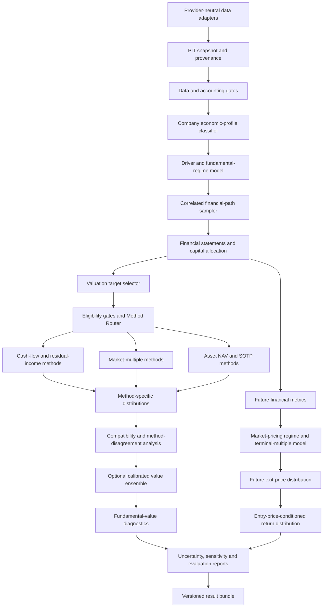

# VMS-0.2 Specification
## Adaptive Multi-Method Valuation Engine

- **Document type:** Engineering SPEC
- **System:** Standalone valuation and conditional-return engine for DSDE
- **Version:** VMS-0.2
- **Status:** Build specification; phased implementation required
- **Initial market:** China A-share equities
- **Runtime:** Python 3.11+
- **Dependency policy:** Standalone. No imports from prior PIT/FTD/DV1, Thorp-engine, or legacy valuation projects.
- **Supersedes:** VMS-0.1. This document is the source of truth for VMS-0.2; do not implement VMS-0.1 first and then bolt on method routing as an afterthought.

---

## 1. Executive summary

VMS-0.2 replaces the single-default-method design of VMS-0.1 with an **Adaptive Multi-Method Valuation Engine**. It must identify the economic characteristics of a company, determine which valuation methods are valid for the company and the requested valuation objective, produce method-specific distributions, expose disagreement and uncertainty, and separately model how the market may price the company at a future exit date.

The central design is not “run every valuation method and average the answers.” It is:

1. Reconstruct the information set available at the decision timestamp.
2. Characterize the company's economic structure and financial condition.
3. Route the company to eligible valuation methods for a specific target.
4. Generate method-specific value distributions with explicit assumptions and validity diagnostics.
5. Compare methods without assuming they measure exactly the same object.
6. Combine distributions only where the target and calibration protocol justify combination.
7. Model future market pricing separately from fundamental value.
8. Convert the joint paths into entry-price-conditioned return distributions.

VMS-0.2 is designed to answer:

- Which valuation methods are applicable to this company, at this date, for this purpose, and why?
- What distributions of fundamental value do eligible methods imply?
- Are those methods in agreement, and what explains their disagreement?
- Which components of the result are driven by operating uncertainty, valuation assumptions, method choice, data quality, and market repricing?
- What future exit-price and total-return distributions arise at a given entry price, fundamental state, market-pricing state, and holding horizon?

**It is not a single-target-price predictor and it must not claim that a simulated distribution is calibrated merely because it contains many Monte Carlo paths.**

## 2. Core principles and non-negotiable invariants

1. **No universal valuation method.** FCFF DCF is important, not universally primary. The company's economics and the target being valued determine method eligibility.
2. **Route before calculating.** Each method must pass explicit eligibility gates before its output can be used. A disabled, invalid, or unsupported method cannot be silently treated as a valid estimate.
3. **Do not average unlike objects.** Enterprise value, equity value, asset NAV, intrinsic value, peer-relative value, and future market price must be normalized and labeled before comparison.
4. **Keep intrinsic value separate from market price.** Fundamental value is not assumed to be equal to future market price. Any convergence assumption must be explicit, uncertain, configurable, and evaluated separately.
5. **Price and information jointly determine odds.** A lower entry price mechanically increases return for fixed future-price paths, but does not repair a changed fundamental distribution. A price decline alone does not prove deterioration.
6. **Distributions are primary outputs.** Point estimates are summaries only.
7. **No false precision.** Report method disagreement and uncertainty. Do not conceal them in an arbitrarily averaged point estimate.
8. **Information-time integrity.** Use only data that were public by `as_of`; preserve historical versions and provenance.
9. **Accounting consistency.** Financial projections, capital allocation, valuation bridges, shareholder distributions, and share counts must reconcile.
10. **Separate uncertainty sources.** Process, parameter, regime, method/model, data, and market-pricing uncertainty must be traceable.
11. **Evaluation target must match the claim.** Future market prices are not direct ground truth for intrinsic value. Operating forecasts, intrinsic-value assumptions, market-price forecasts, and return forecasts are distinct targets.
12. **Engineering success is not investment alpha.** No performance claim without predeclared, leakage-safe, out-of-sample evaluation.
13. **A fallback must be visible.** Every fallback, manual override, and unsupported state must be explicit in configuration and output artifacts.
14. **No legacy coupling.** VMS-0.2 must be runnable without DSDE and without prior research repositories.

## 3. Scope

### 3.1 In scope

- Point-in-time (PIT) financial, market, corporate-action, share-count, peer, industry, and macro assumptions where available.
- Data lineage, quality gates, and accounting consistency checks.
- Company economic-profile classification with confidence and multi-label indicators.
- Driver-based operating and financial-statement projections.
- Fundamental regime estimation and correlated path simulation.
- A method registry, eligibility gates, and deterministic method router.
- Method-specific distributions for supported cash-flow, earnings/multiple, and asset-based valuation approaches.
- Method disagreement and uncertainty attribution.
- Fundamental value distribution, distinct from a future market-price distribution.
- Terminal market-pricing and exit-price distributions conditional on financial paths and market-pricing states.
- Entry-price-conditioned total-return distributions across configurable holding horizons.
- Walk-forward evaluation, calibration, sensitivity, and reproducible run artifacts.
- A documented optional DSDE adapter.

### 3.2 Out of scope

- Portfolio construction, Robust/Fractional Kelly sizing, position sizing, and trading execution. Those belong to DSDE's decision layer.
- Guaranteed price convergence to estimated intrinsic value.
- A universal, opaque “AI valuation score.”
- Treating a peer median as truth or treating a DCF output as truth.
- Automatic use of LLM-generated narratives as calibrated probability estimates.
- A promise that the engine will identify profitable securities without out-of-sample evidence.
- An assumption that every security must receive one blended fair-value number.

### 3.3 Standalone acceptance rule

A clean checkout must be able to run an offline synthetic-company example through data validation, profile routing, one or more applicable methods, market exit-price generation, and return-distribution generation. No external credential or previous project is required for the synthetic example.

## 4. Terminology: define the object before valuing it

VMS-0.2 must use the following terms consistently.

- **Enterprise value (EV):** Value attributable to operating assets before the relevant equity-claim bridge.
- **Equity value:** Value attributable to common equity after explicit treatment of debt, cash, minority interest, preferred claims, leases/pensions when applicable, and other senior claims.
- **Fundamental value:** Model-based value implied by forecast economic cash flows, residual income, or appropriately valued assets under explicit assumptions. It is not directly observable ground truth.
- **Relative value estimate:** Value implied by a market-derived valuation metric or multiple, normalized for the target company and peer selection protocol.
- **Current market price:** Observed tradable price at the decision timestamp, adjusted consistently for corporate actions where required.
- **Future market/exit price:** A modeled price at horizon H that reflects future financial metrics and the distribution of market pricing (e.g., terminal multiples, pricing regime, discount/premium).
- **Method-specific distribution:** A distribution produced by one eligible valuation method, including its own driver paths and method-specific parameter uncertainty.
- **Ensemble distribution:** An explicitly justified mixture of compatible method-specific distributions. It is not a simple average of method medians.
- **Method disagreement:** Dispersion between eligible methods after they have been normalized to a comparable target and timestamp.
- **Market-pricing regime:** A market valuation state, such as compressed, normal, or expanded multiples, distinct from the company's fundamental regime.
- **Method eligibility:** Whether a method's conceptual assumptions and input requirements are met.
- **Method calibration:** Evidence that a method's stated forecast distribution has appropriate behavior against a clearly defined, observable target. It does not prove intrinsic value is known.

## 5. System architecture



### 5.1 Distinct valuation tracks

The implementation must maintain two conceptually separate tracks.

**Track A — Fundamental value**
- Estimates current or future fundamental value under explicit economic assumptions.
- Uses eligible intrinsic valuation methods and, where configured, separately reported relative-value estimates.
- Reports assumptions and uncertainty; does not claim observed ground truth.

**Track B — Future market pricing**
- Generates future market prices from projected financial metrics and a separately modeled distribution of market multiples/pricing states.
- May include persistence, mean reversion, regime transitions, liquidity/valuation discounts, or premium scenarios, but each must be explicit and testable.
- Must not set `future_price = future_intrinsic_value` by default.

The return engine uses Track B's future price distribution plus consistently modeled shareholder distributions. Track A can be used as a diagnostic or an explicit input to market-pricing scenarios, but it must not silently replace the future market-price model.

### 5.2 Module boundaries

| Module | Responsibility |
|---|---|
| `schemas/` | Typed, versioned domain contracts |
| `data/` | Source adapters and canonical ingestion |
| `pit/` | Availability-time snapshots and revisions |
| `quality/` | Provenance, missingness, accounting and quality gates |
| `profiles/` | Economic profile and classifier diagnostics |
| `drivers/` | Driver construction, estimation, transformations and bounds |
| `regimes/` | Fundamental and market regime probabilities/transitions |
| `sampling/` | Correlated path sampling and uncertainty propagation |
| `statements/` | Income statement, balance sheet, cash flow projection |
| `capital_allocation/` | Debt, dividends, buybacks, issuance and dilution |
| `methods/` | Method registry and individual valuation methods |
| `router/` | Eligibility gates, routing and target-specific candidate selection |
| `ensemble/` | Compatibility checks and optional distributional combination |
| `market_pricing/` | Exit-multiple and market-pricing regime model |
| `equity_bridge/` | EV-to-equity and per-share normalization |
| `returns/` | Entry-price-conditioned total-return distributions |
| `diagnostics/` | Sensitivity, disagreement and uncertainty attribution |
| `evaluation/` | PIT-safe walk-forward evaluation and calibration |
| `reporting/` | Human-readable reports and machine-readable result bundles |
| `cli/` | Reproducible command-line interface |
| `adapters/dsde/` | Optional downstream output adapter only |

No module may silently read private state from another module. Dependencies flow through typed public contracts.

## 6. Data contracts and point-in-time rules

### 6.1 Required provenance fields

Every observation must preserve, where applicable:

- `instrument_id`
- `period_end`
- `published_at` (when the information became public)
- `ingested_at`
- `source_id` and `source_document_id`
- `revision_id` / source version
- `currency`, `unit_scale`, and accounting basis
- `quality_status`: `OBSERVED`, `DERIVED`, `MISSING`, `NOT_APPLICABLE`, `LOW_CONFIDENCE`
- `derivation_rule_id` for derived values

A record may be used in a run only if its `published_at <= as_of`. A later restatement must not overwrite what was known historically. Where historical vintages cannot be reconstructed, set `PIT_INCOMPLETE` and prohibit the run from supporting claims of unbiased historical calibration.

### 6.2 Canonical financial data

- **Income statement:** revenue, cost of revenue, gross profit, EBIT/operating profit, interest expense, tax expense/effective tax rate, parent-attributable net income, D&A, and material non-recurring items.
- **Cash flow:** CFO, capex, acquisition/disposal cash flows where material, dividends, share repurchases/issuance proceeds, debt issuance/repayment.
- **Balance sheet:** cash and restricted cash, interest-bearing debt, lease liabilities when material, receivables, inventory, payables, operating contract assets/liabilities, fixed assets, goodwill/intangibles, total equity, minority interest and other material claims.
- **Market/share:** raw close, adjusted price or corporate-action events, shares outstanding, diluted shares if available, market cap, distributions, suspension/price-limit flags where available.
- **Peers:** identifier, point-in-time industry/profile, financial metrics, share/enterprise-value bridge fields, derived multiple, exclusion/eligibility status, source and timestamp.
- **Assumptions:** risk-free rate, equity risk premium, cost of debt, tax conventions, terminal growth, peer filters, valuation multiples, market-regime priors, capital-allocation policy and their source/version.

All amounts require currency and scale. Normalize internal currency/units but preserve original source values. For A-shares, distinguish CNY from ten-thousand/million CNY reporting units and distinguish consolidated from parent-only statements.

### 6.3 Minimal contract sketch

```python
@dataclass(frozen=True)
class FinancialObservation:
    instrument_id: str
    period_end: date
    published_at: datetime
    statement_type: Literal["income", "cash_flow", "balance_sheet"]
    field_name: str
    value: float | None
    currency: str
    unit_scale: str
    source_id: str
    revision_id: str | None
    quality_status: QualityStatus

@dataclass(frozen=True)
class ValuationRequest:
    instrument_id: str
    as_of: datetime
    spot_price: float
    horizons_years: tuple[int, ...]
    entry_prices: tuple[float, ...]
    paths: int
    random_seed: int
    target: Literal["fundamental_value", "market_exit_price", "returns", "all"]
    config_version: str
```

Production types may use Pydantic or validated dataclasses. The final implementation must validate timezone awareness, units, positivity constraints, allowed enums, and schema versions.

### 6.4 Data-quality gates

Required checks include duplicates/conflicting sources, unit and currency mismatch, future-publication leakage, restatement leakage, incomplete fiscal periods, cumulative-quarter conversion, accounting identity, working-capital sign conventions, corporate actions, share-count changes, peer contamination, non-positive/meaningless valuation denominators, missing bridge items and provenance gaps.

Run status:
- `PASS`
- `PASS_WITH_WARNINGS`
- `BLOCKED`
- `PIT_INCOMPLETE`
- `UNSUPPORTED_PROFILE`
- `INSUFFICIENT_METHOD_COVERAGE`

Critical accounting/PIT errors block production mode. Exploratory override must identify the override, author/source, timestamp, reason, and affected output fields.

## 7. Company economic-profile model

### 7.1 Purpose

The profile classifier does not directly choose a stock or predict returns. It describes the company's economic and accounting structure so that the router can determine which methods are conceptually valid.

### 7.2 Baseline profile labels

A company may have one primary profile plus independent flags; profiles should not be forced into mutually exclusive industry buckets if economics are hybrid.

Primary profiles:
- `MATURE_OPERATING`
- `GROWTH_OR_REINVESTMENT_HEAVY`
- `CYCLICAL_OPERATING`
- `FINANCIAL_INSTITUTION`
- `ASSET_HEAVY_OR_RESOURCE`
- `HOLDING_OR_CONGLOMERATE`
- `DISTRESSED_OR_TURNAROUND`
- `HYBRID_OR_UNCLEAR`

Independent flags may include:
- `CURRENT_FCF_NEGATIVE`
- `EARNINGS_NEGATIVE_OR_UNSTABLE`
- `DIVIDEND_PAYING`
- `HIGH_CASH_OR_NET_CASH`
- `HIGH_LEVERAGE`
- `MAJOR_DILUTION`
- `MATERIAL_NONOPERATING_ASSETS`
- `HIGH_CYCLICALITY`
- `SHORT_PUBLIC_HISTORY`
- `MATERIAL_SEGMENT_COMPLEXITY`
- `LOW_DATA_QUALITY`

### 7.3 Classification method

VMS-0.2 baseline must use an interpretable rule-based classifier with configurable, versioned thresholds and diagnostic features. An optional probabilistic classifier may be added later but cannot replace the interpretable baseline until independently validated.

The classifier returns:
- primary profile and flags;
- profile probabilities or confidence levels where meaningful;
- source features and exact rule hits;
- conflicting signals;
- missing fields;
- `classifier_version`;
- manual override status and reason, if any.

Rules cannot rely on future returns or labels constructed from information after `as_of`. Industry taxonomy alone is insufficient. Financial statement behavior, cash-flow structure, leverage, profitability stability, asset composition and segment complexity must be considered.

### 7.4 Classification uncertainty

If multiple profiles are plausible, preserve profile uncertainty. The router may evaluate methods under each plausible profile and report the sensitivity. Do not silently assign a hard class when confidence is low. A low-confidence profile can narrow method eligibility or return `INSUFFICIENT_METHOD_COVERAGE`.

## 8. Fundamental drivers, regimes and path generation

### 8.1 Driver families

For operating companies, use driver-based models rather than independently forecasting every financial-statement line:

- demand and revenue: price/mix, volume, customer/product/geography concentration when available;
- profitability: gross margin, operating-expense ratios, EBIT margin, effective tax rate;
- working capital: receivables/revenue, inventory/cost, payables/cost and other material ratios;
- reinvestment: capex/revenue, D&A/revenue or asset-based depreciation, R&D/revenue, acquisitions separately;
- financing and allocation: debt, interest cost, operating cash minimum, payout, buybacks/issuance, diluted-share growth.

Other profiles need profile-specific drivers. For financial institutions, model relevant equity drivers such as assets/loans, net interest margin, credit costs, capital ratios, fee income, payout, and dilution; do not force industrial FCFF drivers onto them. If a profile-specific model is not implemented, mark it unsupported.

### 8.2 Fundamental regimes

Baseline configurable states:
- `GROWTH`
- `STABLE`
- `DETERIORATING`
- `RECOVERY`
- optional `DISTRESS` where data justify it.

Use an interpretable rule-based classifier first; optional HMM/state-space approaches require walk-forward evaluation. Fundamental and market-pricing regimes are separate schemas and separate estimators.

### 8.3 Uncertainty taxonomy

Keep separate:
1. Process uncertainty: actual operating outcomes.
2. Parameter uncertainty: limited data to estimate driver and valuation assumptions.
3. Fundamental-regime uncertainty: present/future business state.
4. Model uncertainty: different plausible operating/valuation specifications.
5. Data uncertainty: missing, noisy, derived or revised observations.
6. Market-pricing uncertainty: future multiples, discount/premium and pricing-state transitions.

### 8.4 Sampling requirements

Each simulation path must sample parameters, present/future fundamental regimes, correlated drivers, financial-statement paths and relevant capital-allocation decisions. Revenue, margin, working capital and capex may co-move; material dependencies must not be ignored without a documented justification. Use regime-conditional block bootstrap, a documented multivariate model, or an alternative validated approach; shrink noisy covariance estimates when data are sparse.

Every path carries a path ID, sampler version, parameter draw ID, regime path, driver path and validity/rejection reason. A failed path cannot silently be included in any quantile or mean.

### 8.5 Reproducibility

Given the same raw-data vintage, configuration, code version, seed and path count, outputs must reproduce within documented numeric tolerance. Persist data/config/code hashes, seed, sampler version, method versions and dependencies.

## 9. Financial-statement and capital-allocation engine

### 9.1 Operating-company projection order

1. Revenue and segment mix where available.
2. Cost of revenue/gross profit.
3. Operating expenses and EBIT.
4. Tax, interest and net income.
5. Working-capital balances and changes.
6. D&A.
7. Capex and other reinvestment.
8. CFO, FCFF and/or FCFE as appropriate.
9. Debt, cash, dividends, buybacks, issuance and other capital allocation.
10. Shares outstanding and diluted shares.

Baseline formula for industrial FCFF:

`FCFF = EBIT * (1 - operating_tax_rate) + D&A - Capex - Change_in_operating_NWC`

Baseline formula for FCFE:

`FCFE = NetIncome + D&A - Capex - Change_in_operating_NWC + NetBorrowing`

Implementation must explicitly define treatment of losses/tax shields, leases, stock-based compensation, acquisitions, restructuring, and non-operating assets. Do not mix FCFF/FCFE or their discount rates.

### 9.2 Capital-allocation policies

Support explicit policies such as:
- continuation of a historical payout/allocation policy;
- target payout ratio;
- target leverage band;
- minimum operating cash plus excess-cash distribution;
- conservative no-buyback/no-acquisition baseline.

Policies are assumptions, not claims about management intent. Store them as versioned configuration and include them in sensitivity reports. Equity-value growth must be separated from per-share growth.

### 9.3 Accounting invariants

- Cash-flow movements reconcile to cash and financing transactions.
- Debt issuance/repayment changes debt and cash consistently.
- Repurchases reduce shares and cash according to the modeled price; issuance increases both proceeds and diluted shares according to the contract.
- Dividends are not double-counted in terminal value and shareholder distributions.
- Negative equity/per-share outcomes are preserved where mathematically and economically appropriate; never silently clamp them to zero.
- Every accepted financial path reconciles or carries an explicit exception and cannot be used if the exception violates a hard invariant.

## 10. Valuation target and method taxonomy

### 10.1 Target selector

Every router call must specify exactly one target:
- `FUNDAMENTAL_VALUE_CURRENT`: current equity/EV value under modeled economics;
- `FUNDAMENTAL_VALUE_HORIZON`: fundamental value at a future horizon under modeled economics;
- `RELATIVE_VALUE_CURRENT`: current value implied by market-relative multiples;
- `MARKET_EXIT_PRICE`: likely future tradable market price at a holding horizon;
- `ASSET_NAV`: fair value based on material assets and liabilities;
- `TOTAL_RETURN`: return distribution combining future market prices and shareholder distributions.

Not every method is eligible for every target. A method that estimates current intrinsic value cannot be treated as a terminal market-price model without a separate market-pricing mechanism.

### 10.2 Method families and initial support matrix

| Method | Target(s) | Expected primary use | Key limitations / gates |
|---|---|---|---|
| FCFF DCF | Fundamental value (EV, then equity) | Operating firms with forecastable unlevered cash flows | Requires coherent FCFF, WACC, terminal assumptions; warn on terminal-value dominance |
| FCFE DCF | Fundamental equity value | Companies where shareholder cash flow and financing policy can be modeled | Requires consistent net borrowing and cost of equity; avoid leverage path inconsistencies |
| Dividend Discount Model (DDM) | Fundamental equity value | Mature/distributing companies with reasonably modelable dividends | Unsuitable if payout is absent/unstable and no meaningful dividend policy exists |
| Residual Income Model (RIM) | Fundamental equity value | Financial firms and firms where book equity/ROE are meaningful and clean-surplus assumptions can be assessed | Requires reliable book equity and residual-income accounting bridge |
| P/E | Relative equity value; terminal pricing | Positive, meaningful normalized earnings | Exclude or heavily qualify negative, near-zero, one-off or cycle-distorted earnings |
| P/B | Relative equity value; terminal pricing | Financial firms and asset/book-equity-relevant firms | Book value and ROE quality must be assessed; not universally meaningful for asset-light firms |
| EV/EBIT | Relative EV; terminal pricing | Firms with positive normalized EBIT | Must bridge EV to equity; excludes/qualifies negative or distorted EBIT |
| EV/EBITDA | Relative EV; terminal pricing | Capital-intensive/operating-company comparison where D&A differences are interpretable | Does not replace capex/working-capital analysis; EBITDA is not cash flow |
| EV/Sales | Relative EV; terminal pricing | High-growth or currently unprofitable companies with useful revenue metrics | Requires margin trajectory/quality checks; cannot be interpreted without profitability/reinvestment context |
| NAV / asset-based valuation | Asset NAV; current fundamental support | Resource, property, investment-holding or asset-centric businesses | Requires asset/liability valuation and haircut assumptions; book assets are not automatically fair value |
| SOTP | Fundamental/relative value | Conglomerates or materially distinct segments | Segment-level data and segment-appropriate methods required; group costs/debt/minority claims reconciled |

An additional method may be added only through the method plugin contract, unit/property tests, documented eligibility rules, and a target-compatible output adapter.

### 10.3 Profile-to-method guidance

| Profile | Candidate methods | Default exclusions / warnings |
|---|---|---|
| Mature operating | FCFF DCF, FCFE DCF, P/E, EV/EBIT, EV/EBITDA; DDM if payout is stable | No automatic averaging; test terminal-value share and normalized margins |
| Growth/reinvestment-heavy | Multi-stage DCF if projections are credible; EV/Sales; future-normalized P/E or EV/EBIT where transition is plausible | Negative current FCF or earnings cannot be multiplied by a conventional positive multiple; explicit time-to-scale/breakeven distribution required |
| Cyclical operating | Mid-cycle normalized earnings/cash flow, scenario DCF, EV/EBITDA or P/E on normalized denominator | Do not apply a trailing multiple to peak/trough earnings without qualification; cycle state must be explicit |
| Financial institution | RIM, P/B with sustainable ROE analysis, FCFE, DDM; P/E as secondary method where earnings quality is acceptable | Industrial FCFF/EV/EBITDA methods disabled by default; no superficial EV bridge for bank-like balance sheets |
| Asset-heavy/resource | NAV, SOTP, normalized DCF or EV multiples where appropriate | Asset quality, replacement cost, reserves, liabilities and cycle prices must be modeled; book value alone is not NAV |
| Holding/conglomerate | SOTP, NAV, look-through value and explicit holding-company discount/premium | Avoid aggregating all segments under one multiple if segment economics differ |
| Distressed/turnaround | Scenario-weighted recovery/liquidation/NAV and turnaround cases if inputs support them | Standard going-concern DCF and multiples may be invalid; insolvency claims/waterfall must be handled or profile marked unsupported |
| Hybrid/unclear | Run only methods whose local gates pass; report coverage gap | Do not force the company into a convenient profile to obtain a number |

This matrix is default guidance, not a rule that every method in a row must run. The hard eligibility gates in Section 11 prevail.

## 11. Method registry, eligibility gates and routing logic

### 11.1 Plugin contract

Each method must register:
- `method_id`, semantic version and owner/module;
- supported `valuation_targets` and output basis (`EV`, `EQUITY`, `NAV`, `PER_SHARE`, or `MARKET_PRICE`);
- eligible profiles and explicit exclusion conditions;
- required fields and data-quality minimums;
- assumptions and configuration schema;
- computation interface and diagnostics schema;
- failure/invalid-path reason codes;
- method-specific unit, property and fixture tests;
- calibration target(s), if a calibration procedure exists.

Example interface (illustrative; implementation may refine types without changing semantics):

```python
class ValuationMethod(Protocol):
    method_id: str
    version: str
    def eligibility(self, context: ValuationContext) -> EligibilityResult: ...
    def value_paths(self, context: ValuationContext,
                    financial_paths: FinancialPathBundle,
                    config: MethodConfig) -> MethodResult: ...
    def diagnostics(self, result: MethodResult) -> MethodDiagnostics: ...
```

### 11.2 Hard eligibility gates

A method is not eligible if any required hard condition fails. Examples:
- Required denominator is negative, zero, near-zero or economically meaningless under configured criteria.
- Required financial line items fail critical accounting/PIT checks.
- The profile makes the method's economic assumptions invalid.
- Peer data lack minimum count/quality or contain unresolvable look-ahead/survivorship issues.
- Required asset-level data are absent for NAV/SOTP.
- Required dividend/payout behavior is not modelable for DDM.
- Required clean-surplus/book-equity assumptions cannot be assessed for RIM.
- Discount-rate inputs are incoherent or fail validity bounds.

Hard gates must return `INELIGIBLE` with one or more reason codes, not a NaN result disguised as an estimate.

### 11.3 Soft suitability score

After hard gates pass, produce a 0–1 or ordered suitability diagnostic from separately visible dimensions:
- conceptual fit to profile/target;
- input data completeness/quality;
- denominator/driver stability;
- peer or historical sample support;
- parameter identifiability;
- out-of-sample calibration evidence;
- sensitivity/fragility.

A single opaque score is prohibited. Keep the dimension vector and rationale. Suitability score does not itself equal ensemble weight.

### 11.4 Deterministic routing procedure

1. Validate the request and target.
2. Determine profile distribution and independent flags.
3. Enumerate methods registered for that target.
4. Apply hard gates; record every pass/fail and reason.
5. Compute soft suitability diagnostics for eligible methods.
6. Run the eligible methods only; method failure is recorded with a reason.
7. Normalize eligible results to comparable units/targets where mathematically valid.
8. Report candidate methods, excluded methods, coverage gaps and model disagreement.
9. Build an ensemble only if Section 13's compatibility and calibration rules are satisfied.
10. Never fabricate a single combined estimate if no method is eligible or if the methods measure incompatible objects.

Router outputs must be deterministic for identical inputs/configuration. A human/LLM may propose a configuration, but production routing cannot depend on an unlogged natural-language judgment.

## 12. Method calculation requirements

### 12.1 FCFF DCF

For each financial path:

`EV = PV(forecast FCFF) + PV(terminal value)`

Inputs must include explicit PIT-aware assumptions for risk-free rate, equity risk premium, beta/proxy, cost of debt, tax rate, target capital structure and resulting WACC. A default assumption can be provided, but its source, timestamp, fallback rationale and uncertainty must be recorded.

Perpetuity-growth terminal value:

`TV = FCFF[n+1] / (WACC - g)`

Requirements:
- Enforce `WACC > g + safety_margin` according to config.
- Bound terminal growth with a documented nominal-growth constraint.
- Treat terminal growth, WACC, and normalization assumptions as uncertain inputs or mandatory sensitivities.
- Report terminal value as a share of EV and flag excessive dependence.
- Reject invalid paths with reason codes; do not silently repair the denominator.
- Handle negative near-term cash flow with a multi-stage model only when the transition is explicitly modeled and plausible.

### 12.2 FCFE DCF

`EquityValue = PV(FCFE forecast) + PV(terminal FCFE)` discounted at cost of equity.

Requirements:
- Net borrowing and leverage policies must reconcile with debt/cash paths.
- Cost of equity must be independently explicit; WACC cannot be substituted.
- Do not use an enterprise-value bridge after directly computing equity value unless the method contract explicitly calls for a reconciliation check.

### 12.3 Dividend Discount Model

Model dividends as a policy-dependent distribution, including payout capacity, retention, issuance/buyback interactions where material, and stress scenarios. Discount to equity at cost of equity. The Gordon form may be used only when dividends and long-run growth satisfy stated stability constraints. If dividends are absent or erratic without an estimable policy, mark DDM ineligible rather than predicting a convenient dividend stream.

### 12.4 Residual Income Model

Baseline form:

`EquityValue = CurrentBookEquity + PV(future residual income)`

`ResidualIncome_t = NetIncome_t - CostOfEquity * BeginningBookEquity_t`

Use only when book equity, clean-surplus adjustments and forecast ROE are meaningful enough to model. Explicitly handle OCI, buybacks/issuance, goodwill/intangible accounting, excess capital and negative book equity. Report clean-surplus deviations and whether they are modeled, adjusted, or cause the method to be ineligible.

### 12.5 Market multiples

Each multiple method must specify:
- denominator/metric and its normalization rule;
- peer-universe construction and PIT eligibility;
- sector/profile/size/growth/profitability/leverage comparability filters;
- treatment of negative/infinite/outlier multiples;
- robust aggregation or conditional distribution method;
- sample size and dispersion diagnostics;
- conversion to EV, equity value, or per-share price;
- bridge items, share count and dilution treatment.

Do not blindly use the peer arithmetic mean. Possible robust estimators include median, winsorized/trimmed estimates, quantile models, or hierarchical shrinkage; selection must be configured and evaluated. The peer set, included/excluded names and reasons must be persisted.

For P/E or P/B, use equity metrics. For EV/EBIT, EV/EBITDA or EV/Sales, estimate EV first, then apply the EV-to-equity bridge. Do not mix multiples with incompatible accounting definitions. A P/S or EV/Sales result must include the implied margin/reinvestment assumptions or be labeled strictly as relative pricing, not economic intrinsic value.

### 12.6 Cyclical normalization

The method must not treat current earnings as sustainable by default. Estimate a mid-cycle distribution using only information permitted by the historical timestamp, such as a complete cycle of earnings/commodity prices/capacity utilization where available. If a full cycle is unavailable, shrink toward a sector prior and mark `CYCLE_ESTIMATE_LOW_CONFIDENCE`. Run peak/base/trough scenarios with explicit probabilities or an unweighted scenario range clearly labeled as such.

### 12.7 NAV and SOTP

NAV must explicitly value material assets and claims; book balance values are not automatically fair values. Inputs/haircuts may include asset-specific yield, replacement value, observable market value, reserve/production economics, property appraisals, impairment, disposal taxes, corporate overhead, restricted assets, debt and minority claims.

SOTP must:
- split materially different businesses;
- assign each segment an eligible method and segment-specific assumptions;
- eliminate inter-segment items;
- account for group costs, parent debt, minority interests and non-operating assets;
- apply any holding-company discount/premium as an explicit uncertain market-pricing parameter, not an undisclosed plug.

If segment or asset disclosures cannot support a defensible NAV/SOTP, mark it unsupported with a data-gap report.

### 12.8 EV-to-equity bridge

For EV-based methods:

`EquityValue = EV + CashAndNonOperatingInvestments - Debt - DebtLikeClaims - MinorityInterest - OtherSeniorClaims`

Specify the sign and membership of each component. Avoid double-counting leases, pension claims, restricted cash, non-operating investments or claims already deducted in projected cash flow. Use contemporaneous diluted share count and preserve bridge-level outputs. Equity-value methods (FCFE, DDM, RIM, P/E, P/B) must not receive a second EV bridge.

## 13. Method comparison, uncertainty and ensemble rules

### 13.1 Always report method-specific distributions first

For each method, persist:
- eligibility and failure status;
- target and output basis;
- median, mean where meaningful, quantiles and tail values;
- valid-path fraction;
- core assumptions and input provenance;
- terminal-value share or denominator diagnostics where relevant;
- sensitivity results;
- uncertainty dimensions captured versus omitted;
- calibration status and sample support.

The methods table must show why a method is included, excluded or downgraded. “DCF says X, multiples say Y” is not itself enough; report the assumptions that explain the difference where possible.

### 13.2 Compatibility before combination

Methods may only enter the same ensemble if they estimate the same target, at the same timestamp/horizon, in compatible units and with consistent corporate-claim/share-count treatment. A current intrinsic value estimate cannot be averaged directly with a future terminal market price. A method targeting EV cannot be combined with a method targeting equity value before a correct bridge.

### 13.3 Ensemble distribution

If a valid ensemble is justified, use a distributional mixture rather than averaging point estimates:

`P(V | X, target) = sum_m w_m * P_m(V | X, target)`

where `w_m >= 0` and `sum(w_m) = 1`.

An ensemble requires all of the following:
1. Same defined target.
2. Eligible and compatible component distributions.
3. A documented weight protocol fixed before the evaluation period.
4. Adequate calibration evidence for the stated target or a transparently labeled prior-only research mode.
5. Out-of-sample evaluation against the declared forecast target.
6. Reporting of within-method uncertainty and between-method disagreement.

Do not default to equal weights or weights proportional to subjective suitability scores. Such choices may be offered only as labeled exploratory baselines and cannot be the production calibrated ensemble without evaluation. If sample size is inadequate, output method-specific results and a descriptive cross-method range; return `ENSEMBLE_UNCALIBRATED` instead of falsely presenting one blended distribution as definitive.

### 13.4 What can and cannot be calibrated

Intrinsic value is not directly observable. Therefore:
- Operating-driver models can be calibrated against later reported operating outcomes.
- Cash-flow forecast distributions can be calibrated against subsequently observed cash flow under a predeclared accounting definition.
- Peer-relative models can be evaluated for cross-sectional pricing residuals and later pricing outcomes, without claiming that market price is intrinsic truth.
- Future market-price and total-return distributions can be evaluated against realized price/return outcomes.
- Fundamental-value model fit to future market price must be reported as market-price association, not proof of intrinsic-value accuracy.

Weights trained to predict market prices/returns must be labeled `MARKET_OUTCOME_WEIGHTING`; they must not be reused as intrinsic-value reliability weights. Each ensemble config declares its target and scoring rule.

### 13.5 Model uncertainty and disagreement

Report at least:
- dispersion among method medians / distributions after normalization;
- leave-one-method-out ensemble sensitivity when an ensemble exists;
- contribution from method-selection versus within-method parameters where feasible;
- profile-classification sensitivity;
- data-quality impact;
- methods not run due to missing data or unsupported profiles.

A large disagreement is not resolved by silently broadening one method's parameter ranges. Preserve method identity so DSDE can choose whether to penalize, avoid, or otherwise account for model risk.

## 14. Future market-pricing and exit-price engine

### 14.1 Purpose

This engine converts future financial paths into possible market prices. It does not assume the market instantly recognizes fundamental value or converges to it by a fixed date.

### 14.2 Inputs

- Simulated financial metrics at horizon H.
- Current market valuation metrics/multiples as of the decision timestamp.
- Point-in-time eligible peer multiples and historical distributions.
- Current and future market-pricing state distribution.
- Explicit persistence/mean-reversion parameters and uncertainty.
- Corporate actions, diluted share count, distributions and EV-equity bridge.

### 14.3 Market-pricing states

Baseline states may include:
- `COMPRESSED`
- `NORMAL`
- `EXPANDED`
- `DISLOCATION` where data support it.

Estimate states independently from fundamental states. Do not infer market multiple expansion solely from fundamental improvement or infer fundamental deterioration solely from multiple compression. If market data are insufficient, mark market-state inference unavailable and use an explicitly configured fallback distribution with low-confidence status.

### 14.4 Exit-price generation

For each path and horizon:
1. Sample future financial metrics from the corresponding fundamental path.
2. Sample future market-pricing state and state transition.
3. Sample appropriate terminal multiple conditional on profile, metric, growth/profitability/leverage state and market-pricing state.
4. Convert the multiple result to EV or equity value using the matching method's bridge.
5. Apply share count/dilution and corporate-action treatment.
6. Store terminal multiple, pricing state, exit price and reason codes.

The terminal-multiple model must support multiple families (e.g., P/E or P/B for equity metrics; EV/EBITDA, EV/EBIT, or EV/Sales for EV metrics) and must enforce each metric's validity gates. Where multiple market-pricing methods are possible, use the same eligibility and mixture discipline as Section 13. If a future price is instead anchored to fundamental value, that is a separate explicitly named convergence scenario with its own stochastic convergence rate; it must not be the default.

### 14.5 Persistence and mean reversion

Mean reversion may be modeled but must not be imposed as a certainty. Estimate transition parameters with PIT-safe data, allow persistence, and include parameter uncertainty. Compare at least:
- constant/current-state persistence baseline;
- empirical transition/mean-reversion model, if supported;
- alternative slow/fast reversion sensitivities.

If the historical sample does not support credible estimation, do not infer precise mean-reversion rates from a short series.

## 15. Conditional return distributions

### 15.1 Return contract

For entry price `P0`, horizon H, path i:

`R_i(P0, H) = (TerminalPrice_i,H + ShareholderDistributions_i,H - P0) / P0`

If distributions are reinvested, implement and label total-return compounding consistently; otherwise use the non-reinvested cash-distribution convention shown above. Corporate actions, buybacks, issuance and splits must not be double-counted. State which price series convention is used.

### 15.2 Required results

For every entry price and horizon, report:
- mean, median and selected quantiles of total return;
- annualized geometric return with exact convention;
- probability of nominal loss;
- probabilities of crossing configured loss/return hurdles;
- 5th/1st percentile and expected shortfall/CVaR at configured levels;
- future-price and shareholder-distribution components;
- conditional results by supported fundamental and market-pricing states;
- Monte Carlo error/stability diagnostics;
- method/model/data quality flags.

Do not imply that a percentile is a confidence interval for true value unless the construction and calibration justify that interpretation.

### 15.3 Entry-price grid and invariant

Support user-specified entry prices and a configurable grid around spot. For fixed future-price/distribution paths, increasing the entry price cannot improve pathwise return. If new evidence changes the fundamental or market-pricing posterior, all affected distributions must be recomputed jointly. The engine must not hard-code “lower price means higher fundamental probability.”

The engine does not calculate portfolio Kelly weights or claim a universally optimal entry price. It provides conditional distributions to DSDE.

## 16. Diagnostics, sensitivity and reporting

### 16.1 Required diagnostics

- Data quality and PIT completeness.
- Profile classification, confidence and feature rationale.
- Methods considered/eligible/ineligible, each reason, and method output.
- Method-specific input assumptions and uncertainty coverage.
- Method disagreement and ensemble status.
- Fundamental-state and market-state posterior/transition assumptions.
- DCF terminal-value contribution and WACC/terminal-growth sensitivity.
- Multiple denominators, peer composition, sample count, dispersion, and normalized-metric sensitivity.
- NAV/SOTP asset/segment contributions and haircut sensitivity.
- Sensitivity of terminal prices, expected return, loss probability and tail losses, not just a central valuation.
- Attribution to process, parameter, regime, data, method and market-pricing uncertainty where feasible.
- Invalid-path counts and reason codes.

### 16.2 Minimum sensitivity set

Revenue/growth, margin, capex, working capital, WACC/cost of equity, terminal growth, terminal/peer multiple, normalized earnings, payout policy, debt/cash, dilution, profile posterior, fundamental-regime transition, market-pricing-state transition, holding-company discount, asset haircuts and ensemble weights (where calibrated).

Use one-at-a-time and joint scenarios. Joint scenarios must preserve economic dependencies where relevant. Reports must be reproducible from saved run artifacts.

### 16.3 Result bundle

Each run writes a versioned directory including, at minimum:

```text
run_<run_id>/
  request.json
  config_snapshot.json
  data_manifest.json
  data_quality_report.json
  profile_report.json
  fundamental_state_posterior.json
  driver_diagnostics.json
  financial_path_summary.json
  method_eligibility.json
  method_results/
    <method_id>.json
  method_comparison.json
  ensemble_report.json
  market_pricing_report.json
  exit_price_summary.json
  return_distribution_summary.json
  sensitivity_report.json
  evaluation_report.json        # where run type supports evaluation
  simulation_metadata.json
  validation_report.json
  paths/                         # optional partitioned Parquet files
```

Every artifact includes `run_id`, schema version, code version, config/data hashes and timestamps. The report must distinguish `NOT_RUN`, `INELIGIBLE`, `FAILED`, `LOW_CONFIDENCE`, and `VALID` results.

## 17. Historical evaluation and calibration

### 17.1 Walk-forward protocol

At each historical decision timestamp:
1. Reconstruct the PIT information set and contemporaneous peer universe.
2. Fit/update drivers, states, peer distributions and parameters only on permitted past data.
3. Save forecasts before observing outcomes.
4. Evaluate a result only after its target horizon or accounting period matures.
5. Repeat chronologically over securities and time.

Do not randomly split time-series rows. Do not select peers using today's membership for historical periods unless point-in-time membership is explicitly unavailable and the result is barred from unbiased-performance claims.

### 17.2 Separate evaluation targets

Evaluate independently:
- revenue, EBIT, ROE, cash-flow and balance-sheet forecast distributions;
- peer multiple/relative valuation behavior;
- asset NAV inputs where later observable outcomes exist;
- future market-price distribution;
- total-return distribution and risk-event probabilities;
- ensemble calibration for its specifically declared target.

Never label future market price as direct intrinsic-value ground truth. Intrinsic valuation should be assessed through assumptions, component forecast accuracy, sensitivity, consistency, and clearly labeled market-outcome associations, not a single price-error score.

### 17.3 Metrics and benchmarks

Use appropriate combinations of:
- MAE/RMSE or scaled forecast errors for continuous operating outcomes;
- quantile/pinball loss and interval coverage for distributions;
- log score or CRPS where correctly implemented for predictive distributions;
- Brier score/reliability diagrams for event probabilities such as loss probability;
- calibration of return hurdle probabilities;
- stability by profile, sector, fundamental state and market-pricing state;
- peer multiple residuals and temporal stability;
- comparison to transparent baselines.

Baselines must include: historical driver mean/median; deterministic central-case DCF for eligible profiles; simple multiple baseline; no-regime baseline; current-multiple persistence baseline for exit pricing; and profile-appropriate benchmarks. State which baselines are unavailable due to missing data.

### 17.4 Calibration and ensemble release gates

A calibration method or ensemble is production-eligible only when:
- its target is predeclared;
- there is sufficient out-of-sample data for its profile/target or an explicitly justified hierarchical pooling strategy;
- its calibration and proper-score metrics are compared to baselines;
- no material leakage is detected;
- weights and hyperparameters are frozen before the test period;
- subgroup instability is reported.

If insufficient evidence exists, mark `CALIBRATION_INSUFFICIENT` and retain method-specific distributions without a definitive blend.

Use run statuses that distinguish `ENGINEERING_PASS`, `DATA_QUALITY_PASS`, `CALIBRATION_PASS`, `ENSEMBLE_CALIBRATED`, and `INVESTMENT_VALUE_NOT_ESTABLISHED` / `INVESTMENT_VALUE_SUPPORTED`. The last status requires a separate, predeclared out-of-sample research protocol; passing software tests does not imply it.

## 18. Public Python API and CLI

### 18.1 Public facade

```python
class ValuationEngine:
    def validate_inputs(self, request, data_bundle) -> ValidationReport: ...
    def build_pit_snapshot(self, request, raw_data) -> PITSnapshot: ...
    def classify_profile(self, snapshot, config) -> ProfileReport: ...
    def estimate_fundamental_state(self, snapshot, profile, config) -> StatePosterior: ...
    def estimate_driver_distributions(self, snapshot, profile, states, config) -> DriverModel: ...
    def simulate_financial_paths(self, snapshot, profile, states, drivers, config) -> FinancialPathBundle: ...
    def route_methods(self, context, target, config) -> RoutingReport: ...
    def value_by_method(self, context, paths, routing, config) -> MethodResultBundle: ...
    def compare_methods(self, results, target, config) -> MethodComparisonReport: ...
    def build_value_ensemble(self, results, calibration, config) -> EnsembleResult: ...
    def generate_exit_prices(self, paths, market_context, config) -> ExitPriceBundle: ...
    def build_return_distributions(self, exit_prices, entry_prices, horizons, config) -> ReturnDistributionBundle: ...
    def run_diagnostics(self, run_artifacts, config) -> DiagnosticsReport: ...
    def run(self, request, data_bundle, config) -> ValuationRunResult: ...
```

The facade may delegate to internal services. The public method contracts, target distinctions and result semantics must remain stable. API calls must expose typed status/error outputs rather than returning a plausible-looking number when calculation fails.

### 18.2 CLI

Illustrative commands:

```bash
vms validate-data --input data/ --as-of 2026-06-30
vms profile --ticker 000000.SZ --as-of 2026-06-30
vms route --ticker 000000.SZ --as-of 2026-06-30 --target fundamental_value_current
vms value --ticker 000000.SZ --as-of 2026-06-30 --target all --horizons 1,3,5 --paths 50000 --seed 42
vms methods --run-id <run_id>
vms compare-methods --run-id <run_id>
vms sensitivity --run-id <run_id>
vms evaluate --universe config/universe.yaml --start 2018-01-01 --end 2025-12-31
```

Ticker identifiers, data inputs and configuration paths must be configurable. Commands that request unsupported targets/profiles must return structured diagnostics and a non-zero code where execution is blocked.

## 19. Repository structure

```text
dsde-valuation/
  pyproject.toml
  README.md
  SPEC.md
  config/
    default.yaml
    profiles.yaml
    method_registry.yaml
    router.yaml
    market_pricing.yaml
    methods/
      fcff_dcf.yaml
      fcfe_dcf.yaml
      ddm.yaml
      residual_income.yaml
      multiples.yaml
      nav_sotp.yaml
  src/vms/
    schemas/
    data/
    pit/
    quality/
    profiles/
    drivers/
    regimes/
    sampling/
    statements/
    capital_allocation/
    methods/
      base.py
      cash_flow/
      earnings/
      multiples/
      asset_based/
    router/
    ensemble/
    market_pricing/
    equity_bridge/
    returns/
    diagnostics/
    evaluation/
    reporting/
    cli/
    adapters/dsde/
  tests/
    unit/
    property/
    integration/
    leakage/
    methods/
    router/
    calibration/
    evaluation/
  examples/
    synthetic_mature_operating/
    synthetic_growth_company/
    synthetic_bank/
    synthetic_cyclical/
    synthetic_holding_company/
  docs/
    architecture.md
    data_contracts.md
    method_registry.md
    model_card.md
    calibration_protocol.md
```

Every synthetic example must include generated input data, expected qualitative behavior, and assertions about routing and validity; it must not assert fictitious real-world investment performance.

## 20. Phased implementation plan and acceptance criteria

The whole target architecture is specified now, but implementation must be incremental. A phase is complete only when code, tests, artifacts and command outputs provide evidence. Stubs and class shells do not satisfy acceptance.

### Phase 0 — Repository, contracts and deterministic baseline

**Deliverables:** packaging, CI, typed schemas, config validation, run IDs/hashes, exception/status conventions, synthetic fixtures.

**Acceptance criteria:**
- A clean environment installs and runs tests and one offline demo.
- Invalid types, timestamps, units, enum values and config bounds fail with actionable messages.
- Same input/data/config/seed reproduces results within tolerance.
- No imports from previous projects.
- At least one result bundle is emitted with schema version and provenance.

### Phase 1 — PIT data layer and accounting gates

**Deliverables:** CSV/Parquet adapters, canonical data schemas, PIT snapshots, restatement support, quality reports.

**Acceptance criteria:**
- Observations published after `as_of` are excluded.
- Later revisions do not change earlier snapshots.
- Cumulative quarterly flows are converted only under an identified reporting convention.
- Unit/currency and balance-sheet/accounting discrepancies are surfaced.
- Critical errors block production-mode calculation.
- Leakage tests cover financials, peer data, prices and corporate actions.

### Phase 2 — Profile classifier and method registry

**Deliverables:** interpretable profile classifier, flags, profile diagnostics, plugin contract and declarative method registry.

**Acceptance criteria:**
- Synthetic mature industrial, bank, high-growth negative-FCF, cyclical and holding-company fixtures route to expected profile(s) or visibly return low confidence.
- Classifier output can be traced to feature values and rule IDs.
- Manual overrides are versioned and recorded.
- No method runs before hard eligibility gates.
- Every registered method declares targets, units, required fields and failure codes.

### Phase 3 — Driver and financial-path baseline

**Deliverables:** generic operating-company drivers, fundamental regimes, deterministic financial statements, correlated simulation and capital-allocation policies.

**Acceptance criteria:**
- Valid synthetic financial paths reconcile accounting invariants.
- Negative income, tax-loss, negative FCF, capex, working-capital swings, debt and dilution have explicit tests.
- Fundamental and market-pricing state schemas are distinct.
- Fixed seed reproduces the path bundle.
- Sparse history results trigger low-confidence/shrinkage flags.

### Phase 4 — Core cash-flow methods

**Deliverables:** FCFF DCF, FCFE DCF, DDM and their eligibility gates, assumption contracts and diagnostics.

**Acceptance criteria:**
- Hand-calculated fixtures match results within numerical tolerance.
- FCFF uses WACC; FCFE/DDM use cost of equity.
- Invalid discount-rate/terminal-growth relationships are rejected with reason codes.
- Dividend and debt/share paths are not double-counted.
- DCF terminal-value share and key sensitivities are reported.
- Ineligible DDM returns a structured reason, not a fabricated value.

### Phase 5 — Relative valuation methods and PIT peer set

**Deliverables:** P/E, P/B, EV/EBIT, EV/EBITDA, EV/Sales methods; peer construction/filtering and robust multiple distributions.

**Acceptance criteria:**
- Each metric definition, denominator and bridge is explicit.
- Negative/near-zero denominator tests produce correct exclusions/warnings.
- Peer membership and metrics use only PIT-available data.
- Peer set and exclusions are persisted with reasons.
- Outliers and small peer samples trigger documented robustness/uncertainty diagnostics.
- EV- and equity-based methods do not get cross-bridged or double-counted.

### Phase 6 — RIM, NAV and SOTP methods

**Deliverables:** residual income method, asset-based NAV, SOTP framework, segment/asset contracts and reconciliation.

**Acceptance criteria:**
- RIM validates book-equity and clean-surplus conditions or becomes ineligible.
- NAV requires explicit asset/claim assumptions and does not equate raw book assets to fair value without justification.
- SOTP reconciles segments, group costs, debt, minorities and inter-segment items.
- Synthetic bank and holding-company fixtures route to appropriate methods or a visible unsupported state.
- Missing segment/asset data cannot generate an apparently complete NAV result.

### Phase 7 — Router hardening and method comparison

**Deliverables:** deterministic routing, hard gates, soft suitability diagnostics, common target normalization and method disagreement reports.

**Acceptance criteria:**
- Router logs every considered method, hard-gate result, score dimensions, selected/runnable status and reason.
- Same context/config produces the same route.
- Incompatible target/horizon/output basis cannot be combined.
- Method results retain their identity after normalization.
- A profile with no eligible method returns `INSUFFICIENT_METHOD_COVERAGE`, not a default DCF.

### Phase 8 — Ensemble and model uncertainty

**Deliverables:** compatibility checker, explicit ensemble protocols, mixture distributions, calibration metadata and disagreement attribution.

**Acceptance criteria:**
- Uncalibrated or incompatible methods cannot form a production ensemble.
- Mixture weights are non-negative, sum to one, and carry a named target/scoring protocol.
- No default equal-weight blend is exposed as calibrated.
- Ensemble and method-specific distributions are both saved.
- Intrinsic-value weights and market-outcome weights are separate artifacts.
- Leave-one-method-out and between-method disagreement diagnostics work on synthetic examples.

### Phase 9 — Market-pricing regime and exit-price engine

**Deliverables:** independent market-state estimator, conditional future-multiple distribution, terminal EV/equity conversion, explicitly labeled convergence scenarios where supported.

**Acceptance criteria:**
- Fundamental and market pricing states evolve independently unless an explicitly estimated dependence is configured.
- Constant-state baseline runs even when mean-reversion estimation is unsupported.
- Current intrinsic value is not silently copied to future market price.
- Exit-price paths preserve metric/multiple/bridge/share-count lineage.
- Persistence versus mean-reversion sensitivity is reported.

### Phase 10 — Return distributions and DSDE-facing contract

**Deliverables:** configurable entry-price grid, multiple horizons, total-return convention, tail-risk summaries and optional DSDE adapter.

**Acceptance criteria:**
- Hand-worked return fixtures pass, including dividends, share splits, buybacks/issuance where modeled.
- With fixed future-price paths, higher entry price cannot improve pathwise return.
- Conditional updates to fundamental or market-state distributions trigger recomputation of the affected output distributions.
- Quantiles, loss probabilities and expected shortfall are internally consistent.
- VMS runs without DSDE; DSDE integration uses only public versioned contracts.

### Phase 11 — Sensitivity, calibration and walk-forward evaluation

**Deliverables:** PIT-safe walk-forward evaluator, baselines, proper scoring/calibration reports and uncertainty attribution.

**Acceptance criteria:**
- Historical forecasts are persisted before outcomes are read.
- No random row-level time-series split is used.
- Evaluation target is stated separately for operating outcomes, cash flows, market prices and returns.
- Future market price is not treated as ground truth for intrinsic value.
- Calibration metrics compare against simple baselines and include profile/regime subgroup diagnostics.
- If data are inadequate, status is `CALIBRATION_INSUFFICIENT`, not an inferred success.

### Phase 12 — Documentation, end-to-end release and optional adapters

**Deliverables:** model cards, data/method docs, examples, full CLI, result bundle validation and optional DSDE adapter.

**Acceptance criteria:**
- Clean checkout executes offline examples for at least mature operating, growth/negative-FCF, bank, cyclical and holding-company patterns; unsupported outcomes are acceptable only when correctly diagnosed.
- End-to-end outputs include method results, router decisions, market exit prices, return distributions and diagnostics.
- Schema and configuration version migrations are tested.
- Model card lists intended use, unsupported profiles, limitations, known failure modes, data limitations and calibration status.
- No unsupported alpha/profitability claim is present in docs or CLI output.

## 21. Testing strategy

### 21.1 Unit tests

Schemas, PIT filters, fiscal-quarter conversion, profile rules, driver transforms, financial-statement formulas, FCFF/FCFE consistency, DCF terminal value, DDM, RIM, multiple calculations, peer exclusions, NAV/SOTP bridge, route eligibility, ensemble mixture, market-state sampling, shareholder distributions, quantiles, expected shortfall and calibration scores.

### 21.2 Property-based tests

- Holding future-price and distribution paths fixed, a higher entry price cannot improve pathwise return.
- Holding other bridge components fixed, higher debt-like claims cannot increase common equity value.
- Holding equity value fixed, more diluted shares cannot increase value per share.
- Invalid `WACC <= g + margin` paths cannot silently generate valid DCF values.
- Posterior probabilities are finite/non-negative and sum to one within tolerance.
- Ensemble weights are finite/non-negative and sum to one.
- No ineligible method contributes to an ensemble.
- Fixed data/config/code/seed reproduce results within tolerance.
- An EV-based method cannot receive an equity-value bridge twice.
- A current fundamental value cannot become the exit price without an explicit market-pricing rule.

### 21.3 Leakage tests

- Post-as-of financials/restatements are excluded.
- Future peer membership, delisted companies and future prices cannot leak into historical peer samples.
- Future corporate actions are treated according to what was known at the decision timestamp.
- Driver transformations, scaling, imputation, state estimation and calibration use only the permitted past data.
- Ensemble weights and thresholds are frozen before the test window.

### 21.4 Integration tests

Synthetic raw data to PIT snapshot; snapshot to profile/router; path generation to method results; ineligible-method rejection; method comparison; ensemble not-calibrated status; market exit price; return distributions; missing-data failure; run bundle replay; CLI error codes; optional DSDE adapter contract.

## 22. Mandatory anti-patterns

Implementation MUST NOT:
1. Treat FCFF DCF as the mandatory/default truth for every company.
2. Run a method when its conceptual or data gates fail.
3. Average method medians or point estimates without a defined compatible target and validation protocol.
4. Use future stock price as direct ground truth for fundamental value.
5. Set future market price equal to intrinsic value by default.
6. Confuse method suitability scores with calibrated model weights.
7. Use equal-weight blending as a production calibrated ensemble without evidence.
8. Use a current peer universe to backtest historical estimates without acknowledging and gating the leakage.
9. Treat negative/near-zero denominators as valid conventional multiples.
10. Equate EBITDA with cash flow or book assets with asset NAV without adjustments.
11. Double-count dividends, cash, debt, leases, minority interests, repurchases, issuance, or dilution.
12. Silently clamp negative equity or discard failed paths.
13. Treat more Monte Carlo paths as a remedy for model bias or sparse data.
14. Let fundamental regimes and market-pricing regimes collapse into one label.
15. Use an opaque LLM judgment to route methods without a logged, deterministic rule/config.
16. Claim profitability or alpha based solely on unit tests, in-sample fit or attractive simulated outputs.
17. Import code from legacy research systems or require DSDE to execute the valuation core.

## 23. Definition of Done

VMS-0.2 is complete only when:
- All phase acceptance criteria are evidenced by automated tests and reproducible artifacts.
- The offline synthetic examples run from a clean checkout.
- PIT/accounting gates and method eligibility gates are enforced.
- At least the methods committed in the implemented phases produce method-specific distributions and traceable diagnostics.
- Unsupported methods/profiles are explicitly identified; no silent default method is used.
- Method comparison preserves disagreement and does not force a blend.
- Any production ensemble meets the documented target-specific calibration gate; otherwise it is labeled uncalibrated.
- Fundamental value and future market exit price are distinct outputs with separate assumptions.
- Entry-price-conditioned return distributions and risk diagnostics are reproducible.
- Walk-forward reports distinguish operating forecasts, fundamental valuation assumptions, market prices and returns.
- The valuation core works independently; DSDE adapter remains optional.
- Documentation states supported profiles, unsupported cases, limitations, and calibration evidence.

## 24. Codex implementation protocol

Implement phases in order. Do not create all directories/classes as placeholders and declare success. Each phase completion report must include:

1. Exact files added/changed.
2. Commands executed and test counts/results.
3. Acceptance criterion → concrete evidence mapping.
4. Known gaps, unsupported cases and assumptions.
5. Example run artifact path and summary.
6. Whether any criterion failed; failed criteria must not be weakened silently.

Before a phase is marked complete, inspect the implementation against the anti-pattern list and run relevant tests. If a method or profile cannot be implemented honestly with available data, return a structured unsupported/insufficient-coverage state instead of inventing a value.

---

## Appendix A — Example routing behavior (illustrative)

| Synthetic fixture | Expected route behavior |
|---|---|
| Mature manufacturer, positive normalized EBIT/FCF, stable accounts | FCFF DCF eligible; EV/EBIT and EV/EBITDA candidates eligible if peer data pass; P/E eligible if earnings are normalized; DDM only if payout is modelable |
| High-growth software company, negative current FCF, growing sales | Conventional current P/E ineligible; EV/Sales may be eligible as relative pricing; multi-stage DCF only if revenue/margin/reinvestment and transition assumptions pass; exit-price output depends on future metric and terminal-multiple distributions |
| Bank with meaningful book equity and ROE data | RIM and P/B-ROE methods considered; FCFE/DDM if their gates pass; ordinary industrial FCFF/EV EBITDA defaults disabled |
| Cyclical producer near earnings peak | Profile flags high cyclicality; unnormalized trailing P/E is excluded or prominently downgraded; normalized/mid-cycle and scenario approaches are required for a meaningful output |
| Holding company with distinct listed/unlisted segments | SOTP/NAV candidates require segment/asset inputs; group debt/costs/minority interests and holding discount explicit; otherwise return data-gap/unsupported status |
| Company with irreconcilable statements or PIT leakage | Production valuation blocked; no method is allowed to bypass the gate |

## Appendix B — Design decision summary

VMS-0.2 is not simply VMS-0.1 plus more valuation formulas. The architecture changes in four material ways:

1. **Method selection becomes a first-class subsystem** with explicit eligibility, explainable routing and testable profile rules.
2. **Method-specific distributions remain visible**; combination is optional and requires target compatibility and calibration.
3. **Fundamental value is separated from terminal market pricing**, so a correct business-value model cannot silently become a stock-price predictor.
4. **Model uncertainty is preserved as decision-relevant information**, rather than hidden behind one precise-looking valuation number.
